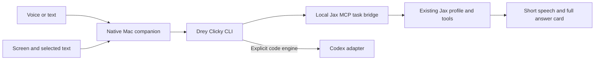

# Drey Clicky

Talk to your Mac. It sees your screen, and Jax does the work.

A native macOS developer preview built on [OpenClicky](https://github.com/prasanthsasikumar/openclicky), with an MCP task bridge to your existing Jax assistant. **MIT licensed; upstream attribution and history are preserved.** This is an independent fork, not an official OpenClicky or VoiceOS release.

## What is here

- Hold **Control + Option** to talk, or type into the native companion.
- Send a screenshot and available selected text with a Jax request.
- Hear a short answer; read the full answer in its card.
- Resume Jax conversations and browse their local history in the Agents panel.
- Use the existing Jax profile and tools. Choose Codex explicitly for code work.
- Stop or cancel a task, with bounded timeouts and no automatic replay on another engine.
- Keep the inherited offline dictation, screen pointer, skills and native companion foundation. Their availability depends on the selected route and macOS permissions.

The visual redesign is awaiting a theme choice; the working OpenClicky interface is retained. VoiceOS trial parity, wake-word detection, Intel packaging and notarized distribution are not claimed. See the verification record for actual executed checks.

## Start

Use Node 22+, Xcode 26+, an Apple Silicon Mac and your existing `jax` profile. Keep the checkout outside iCloud Desktop/Documents.

```sh
npm ci
npm run build -w agent
node agent/dist/cli.js doctor --json
node agent/dist/cli.js run "Say hello in one sentence" --cwd "$PWD" --json
bash scripts/build-drey-clicky.sh
```

The Jax route uses your configured account. No keys ship in this repository. The native companion needs its own settings file and macOS permission grants: [complete setup and recovery guide](docs/DREY-CLICKY.md).

## Architecture and verification

[Editable architecture diagram](docs/diagrams/architecture.mmd) · [Rendered diagram](docs/diagrams/architecture.png) · [SVG](docs/diagrams/architecture.svg)



```sh
bash scripts/gauntlet.sh
```

The gauntlet runs types, lint, source safety, tests, builds, the fork checks and an MCP handshake. Live provider, microphone, screen and spoken-audio verification remain separate checks.

- [Verification record](docs/VERIFICATION.md)
- [VoiceOS, OpenClicky and REA comparison](docs/COMPARISON.md)
- [Measured QuickSilver routing improvement](docs/performance/QUICKSILVER.md)
- [UI interaction standard](docs/UI-STANDARD.md)
- [Release and plugin plan](docs/RELEASE.md)
- [Original OpenClicky guide](docs/UPSTREAM-README.md), [license](LICENSE), [original Mac license](macos/OpenClicky/LICENSE)

## Permission and data model

The gate chooses a lane; it does not authorize an action. Screen and selected text are untrusted evidence. Jax's existing approval rules remain in force; the bridge never adds `--yolo`. External actions still need the user's approval. A timeout can leave work partly performed, so inspect the app before retrying.

The fork has its own bundle identifier, settings, local history and dictation data. It disables the upstream updater so it cannot replace itself with the original app. Local history stores requests and answers in owner-only files; screenshots and selection temporary files are removed by the native route. Your Jax profile and model provider may retain their own conversation data.
